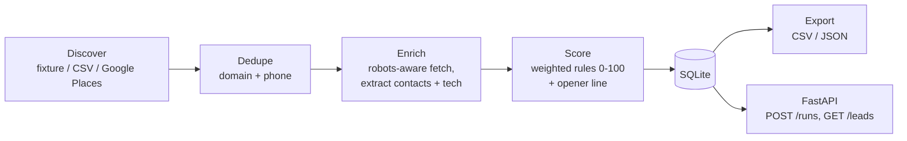

# Lead Intel Engine

**Find local businesses, read their websites, and rank them as prospects for an AI-receptionist offer, with a reason for every point.**

Pipe a niche and a city in; get a scored CSV/JSON lead list out (emails, phones, socials, tech signals, opener line). Runs fully offline in demo mode.



Each stage sits behind a small interface (`Source`, `Fetcher`, `OpenerGenerator`), so swapping one is a single class.

## Quick start (demo mode, no keys, no network)

```bash
git clone https://github.com/huss2003/lead-intel-engine && cd lead-intel-engine
pip install -e ".[dev]"            # or: uv pip install -e ".[dev]"
export DEMO_MODE=1
lie run --niche hvac --city Dallas --source fixture
head leads.csv
```

Step by step: `lie discover`, `lie enrich`, `lie score`, `lie export -f json -o leads.json --min-score 60`.

Real data:

```bash
lie discover --source csv --path my_leads.csv          # columns: name, website, phone, rating, reviews, ...
GOOGLE_PLACES_API_KEY=... lie discover --niche hvac --city Dallas --source places
lie enrich && lie score && lie export
```

API: `lie serve`, then

```bash
curl -X POST localhost:8000/runs -H 'content-type: application/json' -d '{"niche":"hvac","city":"Dallas"}'
curl 'localhost:8000/leads?min_score=60'
```

The API accepts `fixture` and `places` sources only; CSV import is CLI-only so the service never reads arbitrary server files.

Docker: `docker build -t lie . && docker run -p 8000:8000 lie` (demo mode by default).

## Scoring

Weights are in `src/lie/score.py` and sum to 100. Every lead carries a reason per rule.

| Rule | Points | Signal |
|---|---|---|
| Rating | 15 | 4.3+ full, 4.0+ two thirds, 3.5+ one third |
| Review count | 20 | 100+ full, 30+ 70%, 10+ 40% |
| No live chat | 20 | no known chat widget in HTML |
| No online booking | 20 | no scheduler or "book online" signal |
| After-hours gap | 15 | hours published and not 24/7 (half if no hours found) |
| Ad signals | 10 | Google Ads / Meta pixel / click-id markers |

Unenriched leads score only on public rating data. The optional opener line comes from Anthropic (`ANTHROPIC_API_KEY`) or a deterministic mock in demo mode.

## Configuration

| Variable | Default | Purpose |
|---|---|---|
| `DEMO_MODE` | off | Fixture fetcher, mock opener, no network |
| `LIE_DB` | `lie.db` | SQLite path |
| `LIE_USER_AGENT` | `LeadIntelEngine/0.1 (+repo URL)` | Identifies the bot; set a contact URL you own |
| `LIE_CONCURRENCY` | `5` | Max concurrent requests |
| `LIE_DOMAIN_DELAY` | `2.0` | Min seconds between requests to one host |
| `LIE_TIMEOUT` / `LIE_RETRIES` | `10` / `3` | Per-request timeout; retries with exponential backoff on 429/5xx/timeouts |
| `LIE_FETCHER` | `httpx` | `httpx` or `crawl4ai` (`pip install -e ".[crawl4ai]"`) for JS-rendered sites |
| `LIE_DEFAULT_REGION` | `US` | Phone parsing region |
| `GOOGLE_PLACES_API_KEY` | none | Enables `--source places` |
| `ANTHROPIC_API_KEY`, `LIE_ANTHROPIC_MODEL` | none, `claude-haiku-4-5` | Real opener lines |

## Ethics and compliance

This tool builds lead lists. You are responsible for how you use them.

- **robots.txt**: fetched once per origin and honored for every page. `401/403/5xx` on robots.txt means no crawling that site; a missing file means allowed. `Crawl-delay` is honored when longer than `LIE_DOMAIN_DELAY`.
- **Rate limits**: one request per `LIE_DOMAIN_DELAY` seconds per host, a global concurrency cap, timeouts, and backoff. Only the homepage and one contact page are fetched.
- **SSRF guard**: only `http(s)` URLs whose host resolves to public IPs are fetched; redirects are followed manually (max 5) and each hop is re-checked.
- **Public pages only**: no logins, no paywalls, no CAPTCHA bypass, no scraping behind authentication.
- **Honest identification**: a real User-Agent with a contact URL; no spoofing.
- **Cold email (CAN-SPAM)**: use accurate headers and subject lines, identify the message as an ad, include a physical address and a working opt-out, honor opt-outs within 10 business days. Outside the US (GDPR, CASL, PECR) rules are stricter, and B2B exemptions vary. Get advice before sending at scale.
- **Calls and texts (TCPA)**: do not use these leads for autodialed or prerecorded outreach without consent; check Do Not Call lists.
- **Data sources**: Google Places data is subject to Google's terms (caching and storage limits). Check them before keeping that data long term.
- **Data hygiene**: extracted emails are business contacts found on public pages. Delete on request.

## Development

```bash
ruff check . && ruff format --check . && pytest -q
```

Tests use recorded HTML fixtures (`tests/fixtures`, `src/lie/data/sites`) and `httpx.MockTransport`; none touch the network.

## License

MIT, (c) 2026 Hussain.
